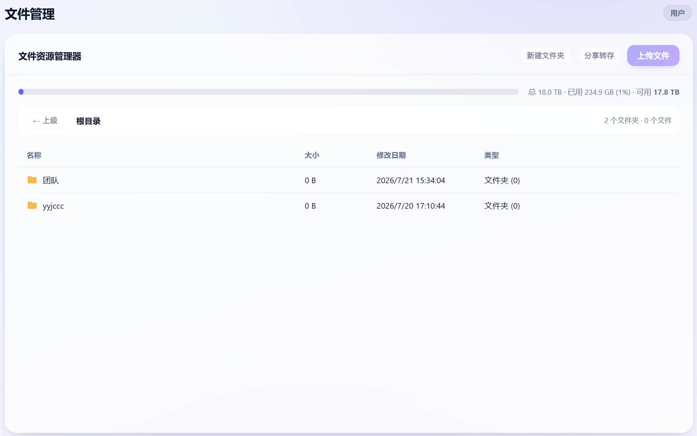
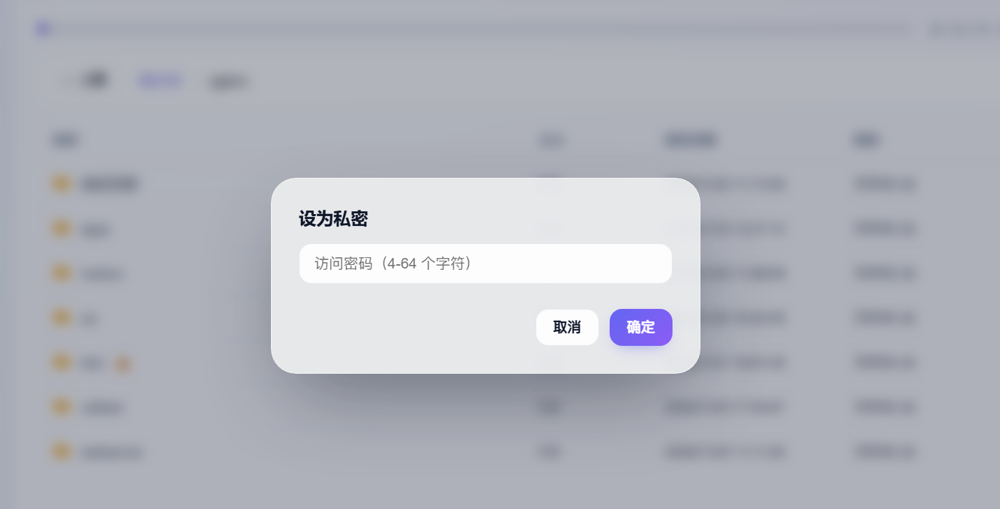
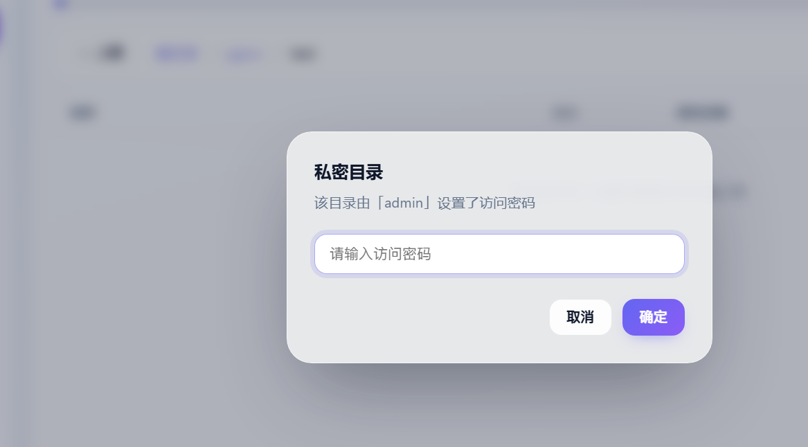
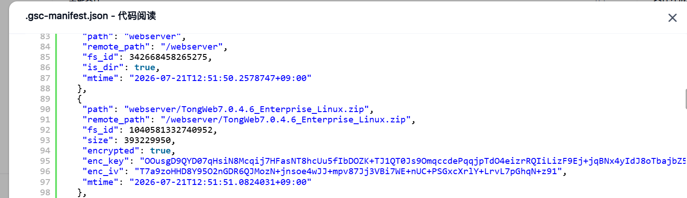
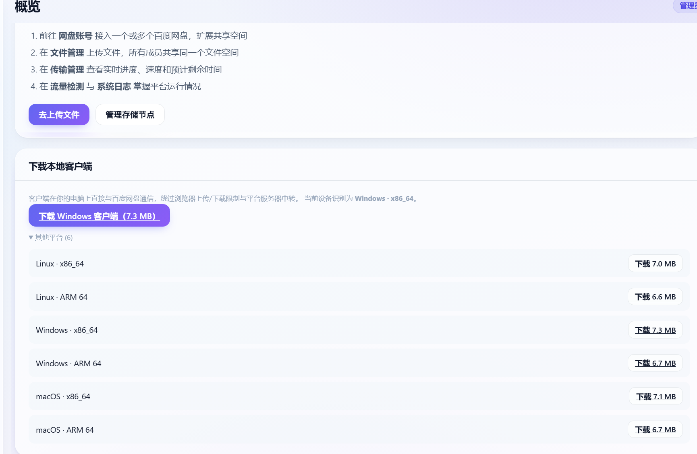
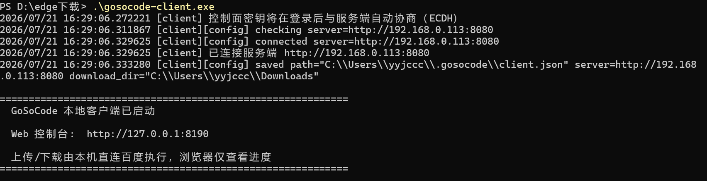
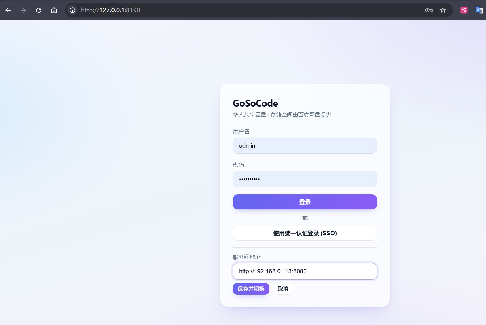

# GoSoCode

把多个百度网盘账号聚合成一个共享文件空间。用浏览器就能上传、下载、搜索和管理文件，也可以安装本机客户端，让数据直连百度网盘，不经过平台服务器。

## 能做什么

- **统一的文件空间**：多个网盘账号显示为共享空间里的目录，成员在同一个界面里协作。
- **文件管理**：上传、下载、新建文件夹、重命名、移动、删除；当前路径会写在浏览器地址栏里，刷新、前进后退，或把链接发给同事，都能回到同一位置。
- **全局搜索**：在文件管理页搜索，会在整个共享空间里查找，不只看当前文件夹。
- **备注**：给文件或目录写备注。简单文字会直接显示在列表里；内容较复杂时显示「备注」标签，点击即可预览。
- **私密访问**：给文件或目录设置访问密码。未授权的人打开或下载前需要输入密码。
- **加密存储**（可选）：上传时使用 AES-256 加密。通过本平台下载会自动解密；直接在百度网盘下载只能得到密文。
- **分享转存**：粘贴别人的百度网盘分享链接，勾选文件后转存到共享空间。
- **传输管理**：上传前会显示校验进度，传输中可暂停、恢复、取消；网络波动时会自动续传。如果文件看起来是密文又无法解密，下载会立即中止，避免空等很久却下到无法打开的文件。
- **本机客户端**（可选）：数据在你的电脑和百度网盘之间直连，通常更快，也不占用服务器带宽。

## 界面一览

### 文件管理

在「文件管理」里浏览共享空间、上传文件或新建文件夹。顶部可以看到容量，列表里是当前目录的内容。

### 传输任务

上传和下载的进度、速度和剩余时间会显示在传输栏和「传输管理」页面，可以随时暂停或取消。

### 私密文件和目录

在文件或目录上右键，选择设置私密并指定访问密码。设为私密后，列表里会有图标标识。

### 加密存储

管理员可以在系统设置里开启加密存储。开启后，新上传的文件会加密保存，列表中同样有图标标识。

网盘侧会保存一份元数据清单（`.gsc-manifest.json`），用于记录文件映射和加密信息。请不要在百度网盘里手动删除或改动这份文件。

### 本机客户端

在「概览」页可以按系统下载客户端。启动后用浏览器打开本地地址，界面和网页版相同，只是上传下载改由本机直连百度网盘。

## 使用说明

更完整的操作说明见 [使用手册](docs/user-manual.md)。常见用法如下：

1. 使用管理员发给你的账号登录。
2. 打开「文件管理」，进入对应目录后上传、下载或整理文件。
3. 用顶部搜索查找文件；给文件或目录添加备注，方便以后辨认。
4. 在「传输管理」里查看进度。大文件建议等云端进度完成后再关闭页面。
5. 若要转存别人的百度分享，打开「分享转存」，粘贴链接后选择目标目录。
6. 经常传输大文件时，可在「概览」下载本机客户端，速度通常更好。

管理员还需要接入百度网盘账号、管理用户和系统设置，步骤见使用手册中的「管理员功能」。

## 自己部署

如果你要在自己的机器上运行 GoSoCode，请看独立的 [开发文档](docs/development.md)，里面有本地启动、配置项、目录结构和部署注意事项。

## 文档

- [使用手册](docs/user-manual.md) — 面向使用者的完整操作说明
- [开发文档](docs/development.md) — 本地开发、配置、架构与部署
- [流式上传设计](docs/streaming-upload-sync.md)
- [客户端模式](docs/client-mode.md)
- [百度接口调优笔记](docs/baidu-client-optimizations.md)

## 许可证

MIT
