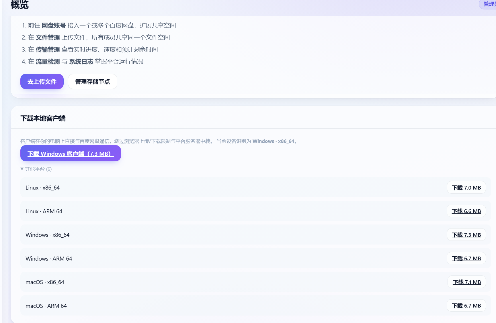
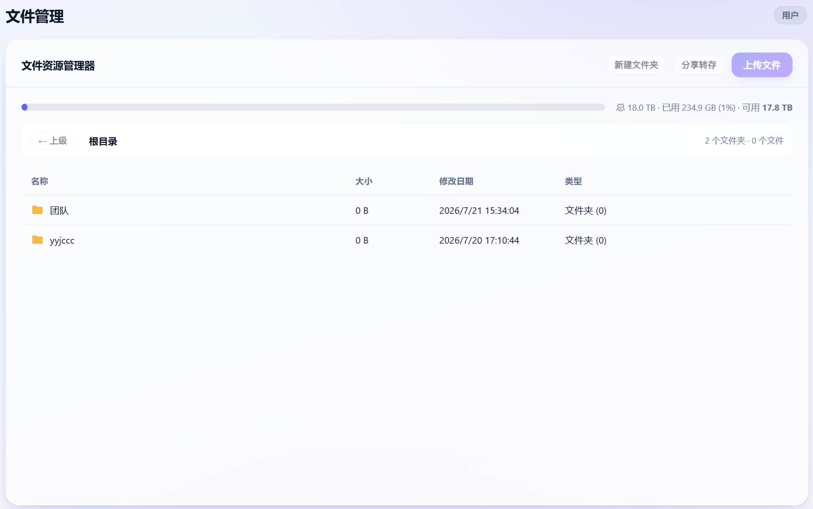
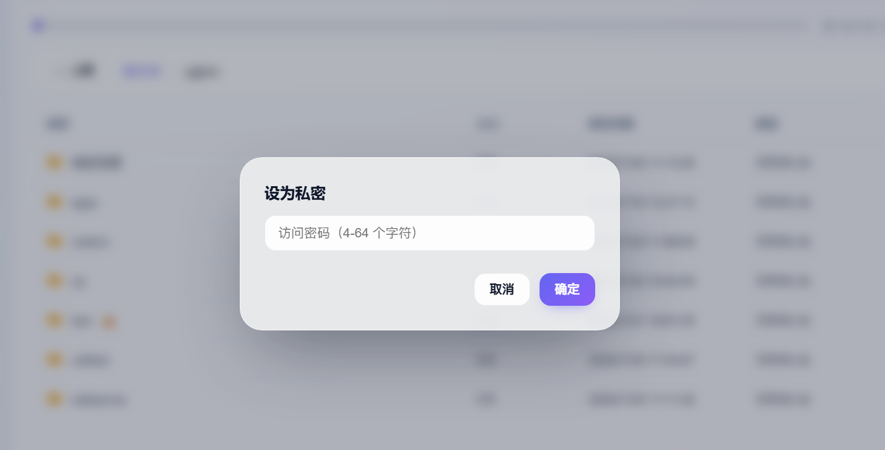
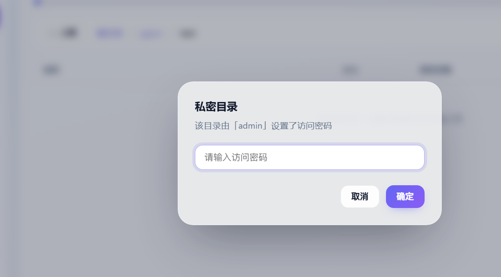
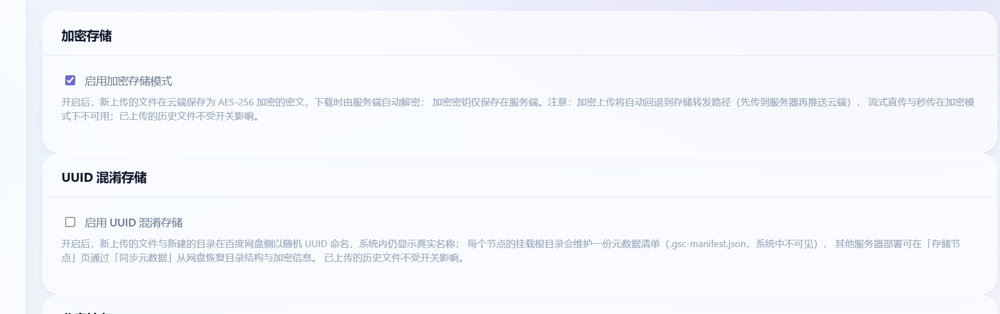
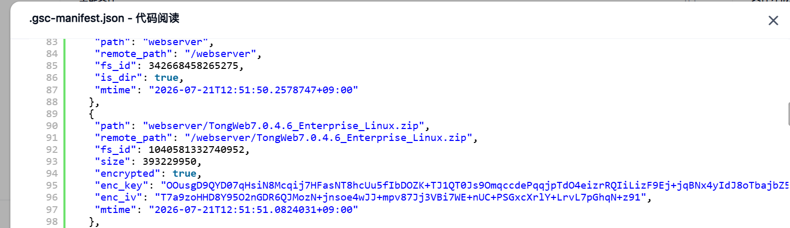
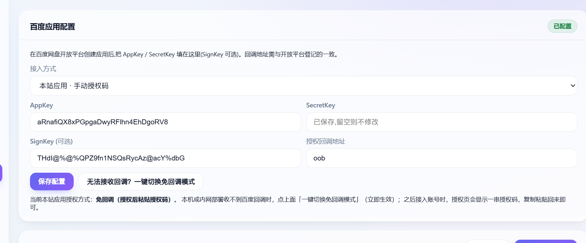
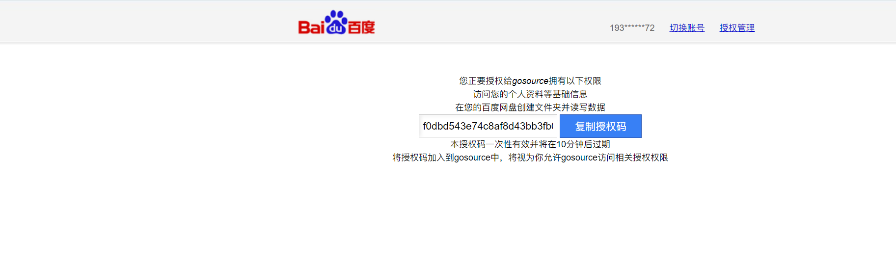
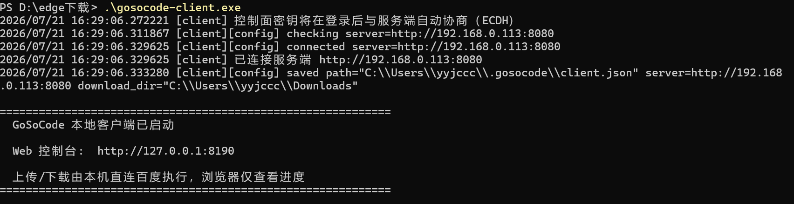
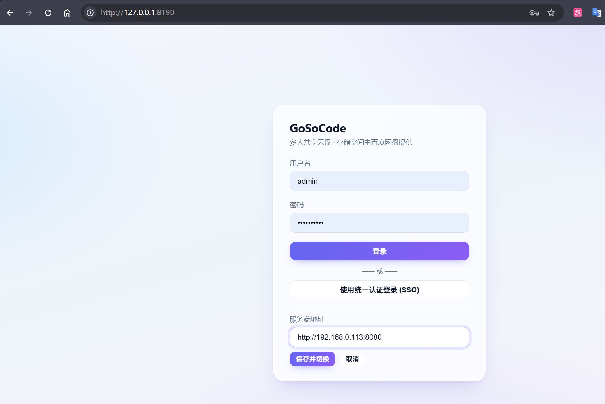

# GoSoCode 使用手册

GoSoCode 将多个百度网盘账号聚合为存储节点，对平台用户呈现为一个统一的共享文件空间。本手册面向普通用户与管理员，覆盖网页和本机客户端的主要功能、注意事项和推荐用法。

更短的功能介绍和界面截图见仓库根目录的 [README](../README.md)。开发和部署请看 [开发文档](development.md)。

## 1. 快速上手

### 1.1 登录

使用管理员为你创建的本地账号（用户名 + 密码）登录。如果管理员启用了 SSO 统一认证（如 Keycloak），登录页还会出现「统一认证登录」入口，登录成功后会直接进入系统。

请向管理员获取自己的账号，不要把真实密码写进文档或发给无关的人。登录后如需修改密码，可在「个人资料」里操作（SSO 账号通常没有本地密码）。

## 2. 用户功能

### 2.1 概览

汇总个人的文件数、累计上传/下载量等信息，并提供到常用页面的快捷入口。如果管理员提供了本机客户端，也可以在这里按自己的系统下载。

### 2.2 文件管理

逻辑根目录下的每个一级文件夹通常对应一个挂载节点（一个百度网盘账号）。进入目录后可以上传文件、创建文件夹、重命名、剪切粘贴或删除。

当前目录或定位到的文件路径会显示在浏览器地址栏里（例如 `#/files/资料盘/文档`）。刷新页面、使用前进后退，或把这个地址发给已登录的同事，都会回到同一位置。访问密码不会写入地址栏。

### 2.3 搜索

在文件管理页面使用搜索，会在整个共享空间中查找，而不是只搜当前文件夹。可以从结果直接定位到文件所在目录。遇到设了密的目录时，需要先输入访问密码，搜索不会泄漏这些目录里的内容。

### 2.4 备注

可以对文件或目录添加备注：在列表中右键选择「备注」。

- 简单文字（没有图片、标题或列表，篇幅也很短）会直接显示在文件名附近。
- 内容较复杂时，列表里会显示醒目的「备注」标签，点击即可预览，不必先打开编辑窗。

### 2.5 传输

上传和下载的进度会显示在页面底部的传输栏，以及「传输管理」页面。底部任务栏主要列出进行中或失败的任务；已完成的任务会自动从栏里消失，完整历史在「传输管理」查看。

- 上传开始前会先校验文件（用于秒传），界面会显示「正在校验，准备秒传…」和进度，不会把校验进度算成已经传完的量。
- 上传显示双进度：浏览器已上传进度，以及云端已确认保存进度。
- 支持暂停、恢复、取消；页面刷新后一般可以继续。
- 遇到短暂的网络波动时，会自动尝试续传；如果多次仍失败，任务会暂停，并提示手动点「恢复」。
- 下载若发现文件已加密但缺少密钥，或内容看起来是密文又无法解密，会立即中止并提示，而不是下载很久才发现打不开。
- 转存任务显示服务器侧进度。
- 可以查看和清空历史传输记录。

建议：大文件传完后，在「传输管理」确认云端进度已经完成，再关闭页面。

### 2.6 私密功能

可以对文件夹或文件设置密码。右键文件或文件夹，选择设置私密。

设置私密后，访问或下载都需要输入密码，列表里会有图标标识。

管理员可以查看或更改密码，也可以取消私密。属主自己访问免密；其他人（含管理员）操作必须输入密码。移动或重命名时，密码规则会一起带走。

私密不等于加密：只是访问要密码，内容在网盘上仍可能是明文（除非同时开启了加密存储）。

### 2.7 加密存储

管理员在系统设置中配置，默认可能开启加密存储。

启用后，上传文件会使用 AES-256 加密后再存到网盘。加密存储的文件在列表中有图标标识。

平台会在对应网盘目录的清单文件（`.gsc-manifest.json`）里同步加密标记以及受保护的密钥信息。

请不要在百度网盘里手动删除或修改这份清单。加密文件如果绕过本平台、直接用百度网盘下载，得到的是密文，无法直接打开。

加密上传或转存需要经过服务器处理，大文件会更耗时，也会占用服务器带宽。

### 2.8 分享转存

把别人分享的百度网盘链接转存进共享空间：

1. 粘贴分享链接（支持整段分享文本，提取码可自动识别或手动填写），点「解析链接」。
2. 在左侧勾选要转存的文件或文件夹（支持全选）。
3. 右侧选择存储节点和目标目录（目录浏览器可逐级进入子目录；进入私密目录会弹出密码框）。
4. 可选项：
   - **文件名随机化**：网盘上的文件以随机 UUID 存储，系统内仍显示原文件名，映射写在清单文件中。适合不希望文件名出现在网盘侧的场景。
   - **加密存储**：默认是网盘侧直接复制（通常很快，内容保持原样）；勾选后会经服务器下载、加密后再上传，更安全，但更慢，也更占服务器带宽。
5. 点「开始转存」。转存在服务器上异步执行，进度在「传输管理」和底部任务栏可见。

注意：

- 转存目标是私密目录时会弹出密码框。
- 文件夹整体转存，其实际大小以转存结果为准。
- 该功能可被管理员整体关闭。

### 2.9 个人资料

- 修改登录密码（SSO 账号通常没有本地密码）。
- 查看或移除自己设置的私密内容。
- 查看文件数、累计上传/下载、注册时间等。

## 3. 管理员功能

### 3.1 用户管理

创建用户、修改资料、启用或停用、设置角色（用户/管理员）、删除。被停用的用户无法登录，实时推送连接也会被拒绝。

### 3.2 网盘账号（存储节点）

添加节点前，先在「系统设置」配置百度开放平台应用（AppKey / SecretKey），然后走 OAuth 授权（跳转授权或粘贴授权码）。

选择免回调模式：

点击接入百度网盘，跳转登录账号：

复制授权码，返回后输入授权码和名称：

提交后即可新增账号节点。

- **挂载名 / 挂载路径 / 备注**：挂载名是用户看到的一级目录名；挂载路径可指定该节点在网盘应用沙箱内的子目录。
- **状态管理**：停用节点后不再参与容量分配与列表展示。
- **刷新**：刷新配额与 VIP 等级（VIP 等级决定上传切片大小：普通 4MB / VIP 16MB / SVIP 32MB）。
- **同步清单**：手动触发时，平台会从网盘拉取并导入清单，用于恢复映射；不会用空内容覆盖网盘上已有的清单。
- **删除节点**：只移除接入关系，不删除网盘数据。删除前请确认其中数据已迁移或不再需要。

### 3.3 流量检测

实时上传/下载速率与按小时聚合的流量曲线，可按用户或节点查看。

### 3.4 系统日志

审计日志：登录、文件操作、转存、配置修改等；保留条数可在系统设置中配置。

## 4. 本机客户端

本机客户端是一个运行在你电脑上的进程：浏览器界面照常使用，但传输数据不再经过平台服务器——上传分片由本机直连百度，下载也由本机分段拉取。控制面（登录、文件元数据、记账）仍然在服务器。

适合大文件传输、服务器带宽有限，或电脑到服务器链路较差、但到百度网盘较顺畅的场景。

### 4.1 下载和启动

在概览页面按系统下载：

也可以在终端启动后访问本地网页，默认是 http://127.0.0.1:8190 ：

可以设置要连接的服务器地址：

登录后，与服务端的控制请求会加密传输；上传和下载则由本地程序与百度网盘通信。

### 4.2 使用上的差异

- 上传按钮变为「选择本机文件」，通过本机文件选择器选文件，客户端直接读取本地路径传输（不经过浏览器内存）。
- 下载落到本机指定目录，完成后显示本地路径。
- 传输进度由本地客户端汇报。
- 「客户端设置」页可切换服务器地址、配置下载目录等；首次启动会引导配置。

## 5. 重要行为与注意事项

1. **列表以网盘实时内容为准，映射和密钥在本地和清单里。** 不要绕过平台，直接在百度网盘 App 里改动挂载目录的内容，否则对账后可能出现名称或路径不一致。
2. **不要删除或改动** 各节点根目录下的 `.gsc-manifest.json`。换服务器部署时，可凭清单恢复映射关系。平台也不会用空清单覆盖网盘上已有的非空清单。
3. **软删除**：平台删除主要标记元数据，远端删除是尽力而为；网盘侧可能仍占容量，节点配额以「刷新」结果为准。
4. **私密规则**：属主免密；其他人（含管理员）操作必须输入密码；管理员可查看密码。私密不等于加密。
5. **加密存储的代价**：加密上传或转存要经服务器处理，大文件更慢；下载解密同样消耗资源。
6. **UUID 化与清单**：开启 UUID 存储，或转存时勾选文件名随机化后，网盘上看到的是无扩展名的 UUID 文件。请一律通过本平台访问。
7. **限流**：所有对百度的 API 调用按节点限速，高并发时任务会排队，这是正常现象。
8. **转存暂存目录**：转存的文件实际放在节点的 `.gsc-imports/` 隐藏目录下（平台不展示），请勿在网盘侧手动清理。
9. **上传中途关闭页面**：流式上传里已经确认的分片不会丢，重新发起一般可以续传；长期滞留的会话由后台定期回收。
10. 多实例部署必须配置 Redis，否则锁和限流只在单实例内有效，详见 [开发文档](development.md)。

### 5.1 上传建议

- 大文件优先使用本机客户端上传（直连百度，通常更快，也不占服务器带宽）。
- 单目录文件数量建议控制在数百以内，过多会拖慢列表与对账。
- 转存他人分享的敏感内容时，可勾选「加密存储」和「文件名随机化」。
- 上传完成后在「传输管理」确认云端进度完成后再关闭页面。

## 6. 常见问题

| 现象 | 说明 |
| --- | --- |
| 上传显示 100%，但仍在「云端处理中」 | 浏览器到服务器已经完成，服务器到百度可能还在推进；稍候即可，也可在「传输管理」里查看 |
| 一开始速度很慢，提示正在校验 | 上传前要计算分片校验值，用于秒传；校验完成后才会进入正式传输 |
| 访问目录提示需要密码 | 该目录被设为私密，请向设置者索取访问密码 |
| 下载立刻失败，提示密文或缺少密钥 | 平台为避免下到无法打开的文件而中止；请联系管理员检查加密密钥或清单 |
| 转存报「应用无分享接口权限」 | 百度开放平台应用未开通分享接口权限，联系管理员 |
| 网盘 App 里看到一堆 UUID 文件 | 正常现象：开启了 UUID 存储或文件名随机化，请通过本平台访问 |
| 节点容量不足 | 管理员在「网盘账号」刷新配额或接入新节点 |
| 本机客户端连不上 | 确认服务器可达、客户端直连功能未被关闭、客户端版本与服务器匹配 |
